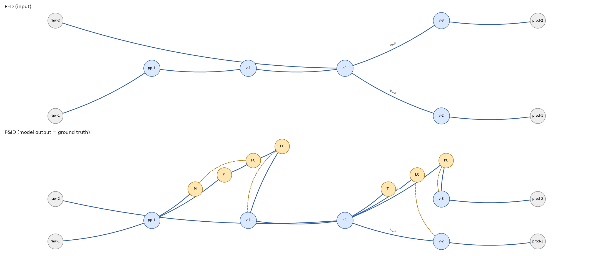
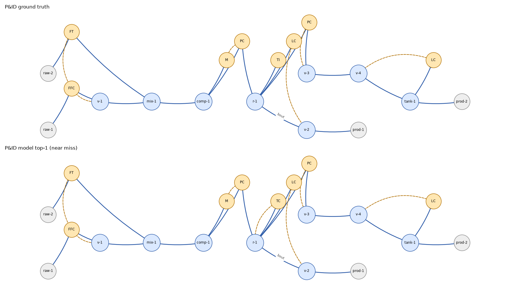

# Generative Process Design

A chemical plant begins as a drawing. The process flow diagram shows the
equipment and the streams that join it: a feed is pumped, heated, reacted, and
separated into products. Before anything can be built, a second drawing must be
derived from the first. The piping and instrumentation diagram adds what the
plant needs in order to run: the valves, the sensors, and the controllers that
hold each temperature, pressure, and liquid level where it belongs. Producing
that second drawing is skilled, repetitive, and done by hand.

This repository builds the data, the checks, and the models needed to produce a
first draft of it by machine. The intended product is a copilot: software that
proposes the next unit operation, drafts the control layer, and points out
topological mistakes, for an engineer who decides. It is not an autonomous
designer, and section 2 explains why the public record cannot support one.

- The plan, with workstreams, tests, fallbacks, and milestones: [`BLUEPRINT.md`](BLUEPRINT.md)
- The inventory of 72 verified public data sources: [`generative-process-design-corpus.md`](generative-process-design-corpus.md)
- The first experimental result: [`docs/poc0.md`](docs/poc0.md)

---

## 1. The problem in one picture



The upper drawing is a process flow diagram, a PFD. Two raw material streams
enter from the left. One passes through a pump and a valve into a reactor; the
other enters the reactor directly. The reactor has two outlets, marked `tout`
and `bout` for top and bottom, and each leaves through a valve to a product.
This is the document a process engineer produces. It states what the plant
does and in what order.

The lower drawing is the piping and instrumentation diagram, the P&ID, for the
same plant. The equipment and streams are unchanged; what has been added, in
orange, is the control layer. The pump has gained a motor and a pressure
indicator, and the feed line two flow controllers, the first driving the pump
motor and the second the valve. On the reactor sit a temperature indicator and
a level controller, and the level controller acts on the bottoms valve, so that
when the liquid rises the drain opens. The top outlet is held at pressure by a
controller acting on its valve.

The dashed lines are signals. Each records which measurement moves which valve.
A plant is built, commissioned, and operated from this drawing, and the hazard
review that precedes start-up walks through it line by line.

Going from the upper drawing to the lower one is the task studied here. In
this instance the model's output and the ground truth are the same drawing.

Nothing in the lower drawing required invention. Each addition follows a
convention that a control engineer applies without deliberation. A vessel that
holds liquid must have its level controlled, and the controller must act on an
outlet. A pump needs a motor and a flow controller on its discharge. A reactor
is held at temperature. A vapor stream leaving a vessel is held at pressure.
The conventions are few, but a working plant has hundreds of streams, each of
which must be considered, and every revision of the process means considering
them all again. That combination, a small rule set applied
exhaustively to a large structure, is what makes the task worth automating and
what makes it learnable.

## 2. What is known, and what is missing

The task is learnable. Hirtreiter, Schulze Balhorn, and Schweidtmann trained a
transformer in 2023 to add control structures to process flow diagrams and
reported 74.8% top-1 and 89.2% top-5 exact match on held-out flowsheets. The
same group showed that a language model trained on flowsheet strings can
complete a partial flowsheet one unit at a time, as a text model completes a
sentence. These results are the reason this project exists.

What those models learned from is the problem. In both studies the bulk of
the training data was synthetic, generated from rules, and the few hundred real
flowsheets each study used were never released: real flowsheets are scarce in
public and encumbered in private. The table summarizes the survey behind this
project.

| Quantity | Value |
|---|---|
| Public sources verified for this project | 72, of which 14 are directly usable |
| Real flowsheets obtainable from all of them, after deduplication | about 1,000 to 1,200 |
| Molecules behind a typical molecular generative model, for comparison | about 10⁸ |
| The largest real corpora ever assembled, none of them released | 1,005 PFDs (Theisen); 312 P&IDs (Hirtreiter); 223 flowsheets (Vogel) |
| Hirtreiter's public training pairs | 100,000, every one synthetic |
| Accuracy of recovering a graph from a scanned drawing (PID2Graph) | about 75% of edges |
| Public sources with operating conditions, sizing, or economics at scale | none |

Molecular design has a hundred thousand times the public data that process
design has, and the gap will not close: the drawings that would close it belong
to the companies that commissioned them. The consequence is a ceiling. With a thousand
real topologies and unlimited synthetic ones, a model can learn what a valid
flowsheet looks like, complete a partial one, place a control layer, and spot
an error, all at the accuracy the literature reports. It cannot learn to invent
an economically sound process it has never seen, and no amount of modelling
will change that. A copilot is what the data supports.

This repository's own first measurement makes the same point from the other
side. A single model, 7.5 million parameters, was trained twice on the public
Hirtreiter pairs: once on ten thousand of them and once on all one hundred
thousand. Nothing else changed.

| Training pairs | top-1 exact | top-5 exact | outputs that parse |
|---|---|---|---|
| 10,000 | 16.5% | 35.8% | 80.6% |
| 100,000 | 42.0% | 81.1% | 98.2% |

Ten times the data raised top-5 accuracy by 45 points. Data, not architecture,
was the limit. Real data will arrive in the hundreds, never in the hundred
thousands, so the question that matters is which model learns from the least.
Section 6 describes the experiment designed to answer it.

## 3. How a flowsheet becomes a line of text

Every model in this repository reads and writes SFILES 2.0, a notation that
encodes a flowsheet graph as a single line of characters. It was designed on
the pattern of SMILES, the line notation most molecular generative models were
trained on, and extended to control structures by the TU Delft Process
Intelligence group. The grammar is small enough to state in full.

| Token | Meaning |
|---|---|
| `(hex)` `(dist)` `(r)` `(pp)` `(v)` `(mix)` `(splt)` | a unit operation; about thirty classes, with `(raw)` and `(prod)` for feeds and products |
| two units written in sequence | a stream from the first to the second |
| `[ … ]` | a branch: a second outlet from the preceding unit |
| `<1` … `1` | a recycle: the stream leaves at `1` and re-enters where `<1` was written |
| `<&| … &|` | a second feed joining the preceding unit |
| `n|` | the start of a separate sub-flowsheet, used for heat integration |
| `{tout}` `{bout}` | a tag on the stream that follows: top or bottom outlet of a column |
| `{1}` on two `(hex)` | the two sides of one physical heat exchanger |
| `(C){TC}`, `_1`, `<_1` | a controller of the given type, the signal it emits, and the unit that receives it |

The drawings in section 1 are these two lines:

```
PFD:   (raw)(pp)(v)(r)<&|(raw)&|[{bout}(v)(prod)]{tout}(v)(prod)

P&ID:  (raw)(pp)[(C){M}<_1](C){PI}(C){FC}_1(C){FC}_2(v)<_2(r)<&|(raw)&|
       [(C){TI}][(C){LC}_3][{bout}(v)<_3(prod)]{tout}(C){PC}_4(v)<_4(prod)
```

Read the second line from the left. The feed enters a pump. A branch off the
pump holds a motor, which receives signal 1. Then a pressure indicator, then a
flow controller that emits signal 1, then a second flow controller that emits
signal 2, then the valve that receives signal 2. The reactor follows, and the
second feed joins it. Two branches on the reactor hold a temperature indicator
and a level controller emitting signal 3. The bottom outlet passes through the
valve that receives signal 3. The top outlet passes a pressure controller
emitting signal 4 and the valve that receives it.

Three properties make the notation suitable as a learning target. The encoding
is lossless and canonical: a graph becomes exactly one string, and the string
parses back to an isomorphic graph, so the canonical string serves as the
identity of a flowsheet and as the key on which duplicates are removed. The
vocabulary is about 120 tokens, so sequence models apply without modification.
And the format is shared: every public corpus and every generator in the
inventory emits it.

The reference implementation needed three repairs before it could serve as a
foundation. It resolved ties in canonical ordering by dictionary iteration
order, so the same flowsheet could produce different strings depending on how
its graph had been built; this repository sorts every graph's edges before
conversion. It accepted malformed strings without complaint, silently dropping
the parts it could not place; this repository treats a string as grammatical
only if it survives a parse and re-serialization unchanged. And it could not
re-read strings carrying hot-side and cold-side labels on heat exchangers, so
those labels are omitted from the canonical form.

## 4. What has been built

```
 sources: DWSIM, Aspen, Pyomo, DEXPI XML, GraphML, Modelica, Hirtreiter JSON
     │   one isolated extractor per source
     ▼
 IR JSON ──► canonical graph ──► SFILES 2.0 string ──► canonical hash
                 │                     │
                 │                     ├──► tokenizer ──► seq2seq model ──► beam search
                 ▼                     ▼
     validity layer: grammar · degree rules · 33 P&ID rules · simulator round-trip
                                       │
                                       ▼
     corpus: every record carries provenance and license; two build profiles
```

| Component | Function | State |
|---|---|---|
| `gpd/canonical` | the intermediate representation, class tables per source, graph construction, the SFILES2 wrapper, canonical and Weisfeiler–Lehman hashes, the tokenizer, the frozen vocabulary with degree constraints | complete; type-checked strictly; property-tested |
| `gpd/corpus` | record schemas with provenance and license | complete |
| `gpd/models` | encoder–decoder transformer, trainer, greedy and beam decoding | complete for the first experiment |
| `gpd/eval` | benchmarks and the regression floor in `baselines.json` | complete for the first experiment |
| `gpd/viz` | renders any SFILES string as a drawing; produced the figures on this page | complete |
| `extractors/hirtreiter` | converts the Zenodo pairs, preserving the authors' splits | complete |
| `scripts/fetch.py` | downloads with checksums and a lock file | complete |
| `gpd/validity` | the 33 engineering rules; the simulator lane | not started |
| extractors for DWSIM, Aspen, Pyomo, DEXPI, PID2Graph, Modelica | the harvest of real flowsheets | not started |

Three decisions shape the code. Every source parser runs in its own
environment and emits one shared intermediate representation, so that the core
package never imports IDAES, WaterTAP, BioSTEAM, or pyDEXPI; the dependency
stacks conflict, and pyDEXPI's license would otherwise attach to everything.
An import checker enforces the boundary. Every record carries its provenance
and license, and the corpus builds in two profiles, one that includes every
source and one that refuses any license that is non-commercial or unconfirmed.
And the canonical layer is tested by property: a generator produces random
valid flowsheets, and the tests require that each survives a round trip to
string and back, that its canonical string does not change when its nodes are
renumbered or its edges reordered, and that its hashes are likewise invariant.
The second of these tests failed on the first day and exposed the
tie-breaking defect described above.

## 5. The first result

The benchmark is the Hirtreiter dataset: synthetic pairs of PFD and P&ID
strings, published under CC-BY-4.0, with the authors' own test split of one
thousand pairs. The model is an encoder–decoder transformer of 7.49 million
parameters, decoded with a beam of five. It trained in 64 minutes on one Apple
M4 Pro.

| Metric on the test split | 10,000 training pairs | 100,000 training pairs | Published |
|---|---|---|---|
| top-1 exact match | 16.5% | 42.0% | 74.8% |
| top-5 exact match | 35.8% | 81.1% | 89.2% |
| top-1 output parses | 80.6% | 98.2% | |
| top-1 equivalent to target after canonicalization | 18.0% | 45.7% | |

Exact match is unforgiving. A single misplaced tag, a recycle numbered
differently, or a branch written in the other order counts as a miss. The
training curves and a fuller discussion are in [`docs/poc0.md`](docs/poc0.md).



The figure shows a miss. In this plant two feeds are mixed, compressed, and
reacted; the bottoms go to product, and the tops pass through a tank on the way
to a second product. Above is the ground truth; below, the model's first
choice. They agree everywhere except at the
reactor, where the truth has a temperature indicator and the model placed a
temperature controller with a signal back to the reactor. From that point every
signal number in the string is shifted by one, so the entire output is scored
wrong. Both choices are defensible engineering. The rules that generated the
benchmark happened to choose the indicator.

The model's second-ranked candidate was the ground truth exactly. That is the
pattern across the test set: the correct drawing is among the model's five
candidates 81% of the time and ranked first 42% of the time. The model knows
what the plausible control layers are. It does not reliably know which
convention the benchmark applies, and nothing in its training signal tells it
why one is preferred.

## 6. The next experiment

The model of section 5 writes the P&ID character by character. Most of what it
writes is a copy of the PFD it was given, and every error it makes is a syntax
error before it is an engineering error. The validity checks sit outside it,
where they can reject an output but not improve one.

The alternative, specified in the blueprint, is to predict the control layer as
a set of loops over the PFD graph. Each loop names the unit measured, the
variable (flow, temperature, pressure, or level), whether it is controlled or
merely indicated, and the valve it actuates. Engineering invariants become
constraints on the prediction rather than checks after it: one valve per loop,
level control only on units that hold inventory, a count of actuators that does
not exceed the count of streams available to manipulate. The string is then
rendered from the graph and the loops, so it is grammatical by construction,
and the decision the model makes at each unit is a choice among about twelve
options rather than a choice among 118 tokens made 130 times in a row.

The two designs will be compared by how little data each needs, because that is
the regime real data will occupy. The rule is fixed before the experiment runs.
If the loop model, trained on ten thousand pairs, reaches the 81% top-5 that
the string model needed one hundred thousand pairs to reach, it becomes the
design. If it lands between 36% and 81%, both continue and the steeper learning
curve decides. If it does no better than the string model did on ten thousand,
it receives one week of diagnosis and is then set aside.

After that comes the harvest of real flowsheets from simulator files and
engineering exchange formats, the implementation of the 33 rules, and the
copilot interface.

## 7. Running it

```sh
make install                      # uv sync, Python 3.11; SFILES2 is a pinned submodule
make check                        # ruff, mypy, import contracts, 150 tests; under a minute

uv sync --extra models            # PyTorch; CPU wheel on Linux, Metal on macOS
make poc0                         # fetch Hirtreiter → JSONL → train → beam-5 evaluation

uv run python -m gpd.viz --pfd "(raw)(hex)(dist)[{tout}(prod)]{bout}(prod)" --out fs.png
```

`make help` lists every target. Continuous integration runs `make check` on
every push.

## 8. Layout

```
gpd/canonical/       intermediate representation, class tables, graph construction, SFILES2 wrapper, hashing, tokenizer, vocabulary
gpd/corpus/          record schemas
gpd/models/          transformer, trainer, decoding
gpd/eval/            benchmarks, baselines.json
gpd/viz.py           flowsheet renderer
extractors/          one isolated parser per source; hirtreiter so far
scripts/             fetch.py and sources.yaml
docs/                poc0.md and figures
tests/               unit, property, and integration tests
third_party/SFILES2  pinned submodule, MIT
```

## 9. Data and licenses

Nothing under `data/` is committed. `scripts/sources.yaml` lists every source
with its URL, license, size, and checksum, and `scripts/sources.lock.json`
records each fetch. The Hirtreiter pairs are synthetic and carry CC-BY-4.0; the
312 real pairs described in the paper were never released. The code is MIT.
Third-party material is itemized at the end of [`LICENSE`](LICENSE).

## 10. References

- Hirtreiter, E., Schulze Balhorn, L., and Schweidtmann, A. M. *Towards
  automatic generation of control structures for process flow diagrams with
  artificial intelligence.* 2023. [arXiv:2211.05583](https://doi.org/10.48550/arXiv.2211.05583).
  Data: [Zenodo 7658798](https://zenodo.org/records/7658798).
- Vogel, G., Schulze Balhorn, L., Hirtreiter, E., and Schweidtmann, A. M.
  *SFILES 2.0: an extended text-based flowsheet representation.* Code:
  [process-intelligence-research/SFILES2](https://github.com/process-intelligence-research/SFILES2).
- Vogel, G., Schulze Balhorn, L., and Schweidtmann, A. M. *Learning from
  flowsheets: a generative transformer model for autocompletion of flowsheets.*
  Computers & Chemical Engineering, 2023.
- Rule-based correction of P&IDs, the source of the 33 rules:
  [arXiv:2502.18493](https://arxiv.org/abs/2502.18493).
- PID2Graph, the drawing-to-graph dataset: [Zenodo 14803338](https://zenodo.org/records/14803338).
- The full source inventory with licenses and verification status:
  [`generative-process-design-corpus.md`](generative-process-design-corpus.md).
